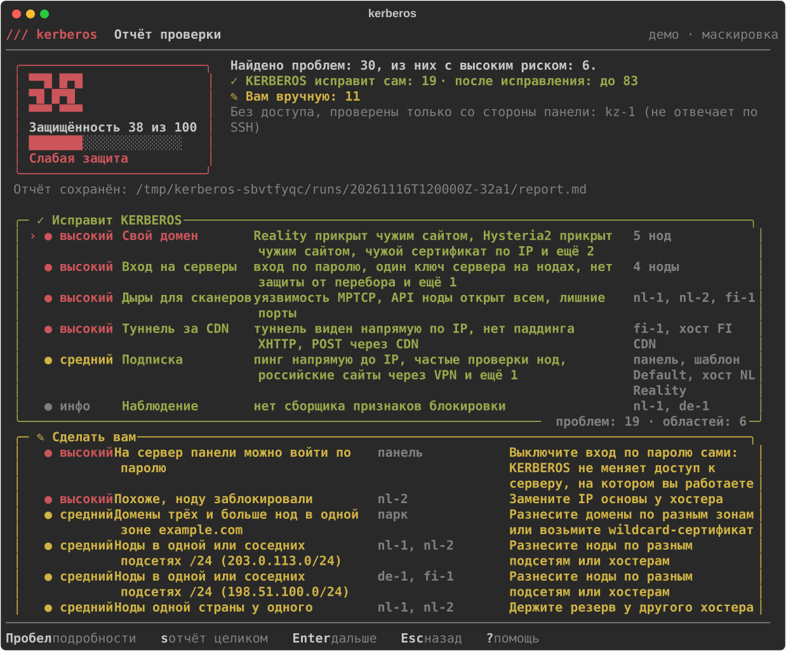
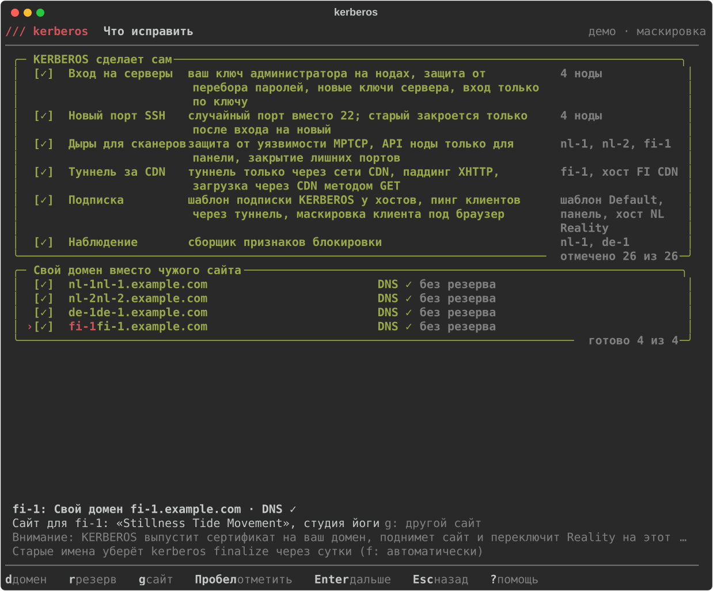
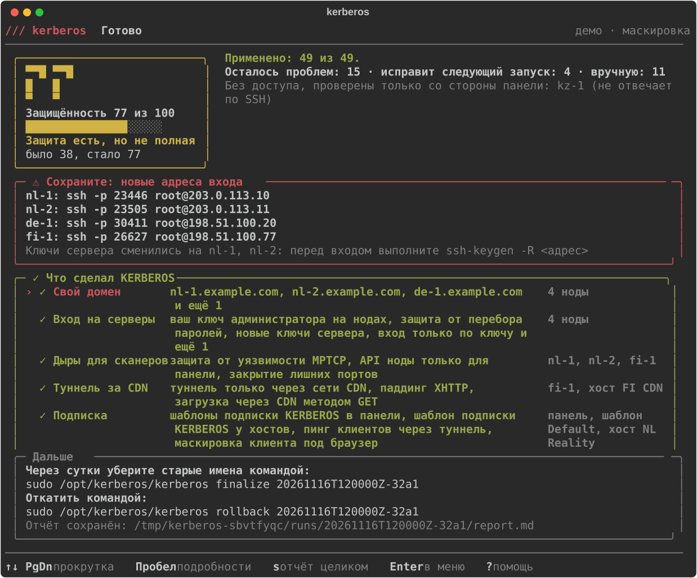

# KERBEROS

**Защита VPN-серверов на Remnawave и 3x-ui.** KERBEROS ставится на сервер панели, сам находит панель и ноды, проверяет их и с вашего разрешения ставит меры защиты: от сканеров РКН, от DPI, от перебора паролей, от связывания нод между собой. Всё делается в одном окне терминала: ничего не нужно править руками, ходить в панель или копировать ключи.



## Что делает

1. **Проверка.** Читает панель и ноды, не меняя их настроек, и показывает красный отчёт: что не так, чем грозит, что из этого KERBEROS исправит сам, а что нужно сделать вручную. Оценка защищённости от 0 до 100.
2. **Исправление.** Показывает план по нодам, спрашивает разрешение и применяет меры по одной: бэкап, изменение, перепроверка. Если что-то не получилось, это изменение откатывается само. В конце зелёный отчёт: что изменилось на каждой ноде, новые порты SSH и отпечатки ключей, бэкапы и команда отката.
3. **Откат.** Возвращает любой прошлый запуск целиком или по одному изменению.

Для владельцев VPN-сервисов и селфхостеров на Remnawave (от 1 до 50 нод) и на 3x-ui (KERBEROS ставится на каждый сервер 3x-ui и защищает его). Быть администратором не нужно: KERBEROS сам объясняет каждую находку простыми словами.

## Установка

```bash
git clone https://github.com/MarselNet86/kerberos.git /opt/kerberos
```

```bash
sudo /opt/kerberos/kerberos
```

Больше ничего: никаких `pip`, `apt` и загрузок. Библиотека для окна (Rich) уже лежит в `vendor/`.

Что нужно:

- сервер, где работает панель Remnawave (контейнер `remnawave/backend`) или 3x-ui;
- Ubuntu 22.04, 24.04, 26.04 или Debian 12, 13 на сервере панели и на нодах;
- Python 3.9 и новее: он есть в этих системах из коробки, а если нет, KERBEROS предложит поставить `python3` и спросит разрешения;
- доступ root (KERBEROS сам перезапустится через `sudo`).

Обновление: `git -C /opt/kerberos pull`.

## Как это выглядит

| | |
|---|---|
|  |  |
| Меню: проверка, исправление, откат, отчёты | План: галочки по нодам, домен для self-steal, сети CDN |
|  |  |
| Применение: бэкап, изменение, проверка, подтверждение | Итог: что изменилось, новые порты и ключи, как откатить |

Скриншоты сняты в демо-режиме с маскировкой адресов: `./kerberos --demo --mask`.

## Команды

| Команда | Что делает |
|---|---|
| `kerberos` | меню: Проверка, Исправление, Откат, Отчёты |
| `kerberos check` | сразу режим «Проверка» |
| `kerberos fix` | сразу режим «Исправление» |
| `kerberos rollback [runId]` | откат запуска или отдельных изменений |
| `kerberos report [runId]` | показать отчёт; без терминала печатает `report.md` |
| `kerberos finalize [runId]` | убрать старые имена у нод, перешедших на свой домен (через сутки) |
| `kerberos ssh <нода>` | войти на ноду с сервера панели ключом администратора |

Флаги: `--demo` (весь сценарий на встроенном парке, без панели и серверов), `--mask` (адреса и домены заменяются на примерные, для скриншотов и видео; на экране то же делает клавиша `m`), `--no-color` (или переменная `NO_COLOR`), `--help`, `--version`.

Коды выхода: `0` готово; `2` неверные аргументы; `3` нет доступа к панели; `4` часть изменений не применилась и откачена; `5` откат не удался, нужна ручная проверка (отчёт говорит, что именно); `130` прервано, незавершённые изменения откачены.

## Как всё проходит

1. **Панель.** KERBEROS сам находит панель на этом сервере; спрашивает, какая она, только если нашёл обе или ни одной. Remnawave пускает программы только по API-токену: создайте его один раз в панели («Настройки Remnawave → API токены → +», кнопка «Создать API токен», права «Полный доступ» или список, который покажет KERBEROS) и вставьте в окно. KERBEROS сохранит токен на сервере (`/var/lib/kerberos/panel.token`, читать может только root) и в следующий раз не спросит. В 3x-ui KERBEROS входит логином и паролем, пароль не сохраняется. На 3x-ui нода одна: сам этот сервер, и шаг 2 пропускается.
2. **Ноды.** Таблица нод панели: отметьте, какие защищать.
3. **Доступ к нодам.** Чтобы проверить ноды изнутри, KERBEROS ставит на них маленький агент; настройки SSH, фаервола и VPN «Проверка» не меняет. KERBEROS показывает отпечатки ключей всех новых серверов одной таблицей: проверьте их и подтвердите одним Enter. Если ключом войти нельзя, он передаёт окно `ssh`: вы вводите пароль ноды, KERBEROS его не видит. Если ноды пускают только по вашему ключу, подключитесь к серверу панели с `ssh -A`: KERBEROS один раз войдёт на них вашим ключом, копировать ключ на сервер не нужно. На ноду ставится маленький агент и ключ KERBEROS, который работает только с адреса сервера панели и только для агента.
4. **Проверка** нод, панели и того, что видно снаружи. Узнать хостеров нод через whois KERBEROS может только с вашего согласия: запрос передаёт адреса нод третьей стороне. Ответ про whois и выбор ключа администратора KERBEROS запоминает и больше не спрашивает; изменить их можно клавишами `w` и `k` на экране доступа к нодам.
5. **Отчёт** с оценкой и находками по шести темам.
6. **План и согласие** (в «Исправлении»): что изменится на каждой ноде и в панели, с предупреждениями. Если домен ноды или её хоста в панели уже указывает на ноду, KERBEROS сам подставляет его для «Своего домена»; старые имена через сутки он уберёт сам. Ничего не меняется, пока вы не выберете «Разрешаю изменения».
7. **Применение** и зелёный отчёт.

## Что проверяет

- **Хостинг и AS:** ноды одной страны у одного хостера или в соседних подсетях; одинаковый ключ SSH у нескольких нод (образ хостера); домены нод в одной DNS-зоне.
- **Свой SNI вместо чужого:** Reality с чужим сайтом в SNI; что отдаёт IP ноды без SNI; маскировка Hysteria2; одинаковые сайты-заглушки на разных нодах; профиль ноды против проверенного шаблона.
- **Защита от сканирования:** вход по паролю, SSH на 22-м порту, fail2ban, MPTCP в ядре, открытый API ноды, лишние открытые порты, origin за CDN, отвечающий напрямую, страница входа панели наружу (у 3x-ui ещё TLS и второй фактор панели), тип пинга клиента.
- **DPI:** паддинг XHTTP, метод загрузки через CDN, fingerprint хостов.
- **Умная маршрутизация:** российские сайты напрямую, частота проб балансировщика, доля российского трафика через ноды.
- **Резервы:** есть ли скрытый резерв у хоста, признаки блокировки ноды.

## Что исправляет сам

На нодах (через агента, с бэкапом каждого файла):

- вход на SSH только по ключу; перед этим добавляет ваш ключ администратора, чтобы вы не потеряли вход;
- новый порт SSH (по вашему выбору); старый закрывается только после входа на новый;
- SSH ноды только для сервера панели (по вашему выбору): сканеры SSH ноды больше не видят, вы входите через сервер панели (`ssh -J`) или `kerberos ssh <нода>`; уже открытые сессии не обрываются;
- новые ключи сервера SSH вместо одинаковых из образа хостера;
- fail2ban для SSH;
- выключение MPTCP и отбрасывание IP-опций;
- API ноды открыт только серверу панели;
- лишние открытые порты закрываются;
- **self-steal:** свой домен, сертификат и сайт-заглушка на ноде, Reality и Hysteria2 на этом домене; копии хостов с новым SNI, старые хосты выключаются (не удаляются), сутки нода принимает и старое имя;
- фильтр на origin за CDN: туннель отвечает только сетям CDN, прямой запрос видит обычную «нет такой страницы»;
- сборщик признаков блокировки (по выбору): соединения, оборванные сразу, и замершие после первых 16 КБ.

В панели (со снимком каждого объекта до изменения):

- профиль ноды по проверенному шаблону KERBEROS, ключи Reality и ваши инбаунды сохраняются;
- шаблоны подписки «KERBEROS» и «KERBEROS single»: российские сайты напрямую, проба раз в 60–90 секунд (своя у каждой панели), переключение на резерв;
- пары основа–резерв со скрытыми хостами резерва;
- `ping-type: proxy-head` в заголовках подписки: клиент меряет задержку через туннель, а не пингом IP ноды;
- fingerprint `chrome` или `firefox` (свой у каждого хоста), паддинг XHTTP на сервере и в подписке со своим диапазоном у каждого инбаунда, загрузка через CDN методом GET.

Диапазон паддинга, отпечаток и проба резерва у разных людей, хостов и инбаундов разные: серверы пользователей KERBEROS не узнать по одинаковым значениям.

Перед самой панелью (по вашему выбору, вход проверяете вы сами из браузера, иначе всё возвращается):

- **Remnawave:** если перед панелью стоит Caddy в Docker по схеме из документации Remnawave, KERBEROS ставит портал входа caddy-security по секретной ссылке, с вашим логином, паролем и вторым фактором; подписки и запросы к API с токеном работают как раньше;
- **3x-ui:** панель переезжает на случайный порт и секретный путь средствами самой 3x-ui; Xray не перезапускается, клиенты не отключаются.

Вручную (отчёт объясняет, что сделать): на 3x-ui включить маршрутизацию подписки и вставить строку `happ://routing`, которую даёт KERBEROS (российские сайты напрямую); перенести ноду от хостера из России; разнести ноды по хостерам и подсетям, закрыть страницу входа панели, выключить вход по паролю на сервере панели, заменить заблокированный IP. KERBEROS не меняет доступ к серверу, на котором вы работаете.

## Безопасность

- **Ничего без разрешения.** «Проверка» не делает ни одного изменяющего вызова. «Исправление» меняет что-либо только после экрана согласия.
- **Ничего не теряется.** Перед каждым изменением бэкап; после него перепроверка; при ошибке изменение откатывается само. Прерывание `Ctrl+C` не оставляет ноду наполовину изменённой.
- **Вас не запрёт.** Изменения SSH ставятся с таймером: если KERBEROS не подтвердил вход новым соединением за три минуты, нода сама вернёт всё как было. Вход по паролю выключается, только когда у вас есть рабочий ключ.
- **Секреты.** Пароль 3x-ui живёт только в памяти. API-токен Remnawave хранится в `/var/lib/kerberos/panel.token` с правами 0600: root этого сервера и так управляет панелью. Пароль ноды читает `ssh`, а не KERBEROS. Приватные ключи лежат в `/var/lib/kerberos/` с правами 0600. В отчётах и журналах нет паролей, токенов, ключей, адресов клиентов, UUID и email пользователей.
- **Ограниченный ключ.** Ключ KERBEROS на нодах работает только с адреса сервера панели и запускает только агента, а не shell.
- **Никакой телеметрии.** Внешний запрос один: whois, и только после вашего согласия.

Как сообщить об уязвимости: [SECURITY.md](SECURITY.md).

## Демо

```bash
./kerberos --demo --mask
```

Весь сценарий на встроенном парке из шести нод: без панели, без серверов и без root. Подходит, чтобы посмотреть окно до установки и для записи видео ([docs/video.md](docs/video.md)).

## Где что лежит

`/var/lib/kerberos/` на сервере панели (0700, root):

| Путь | Что |
|---|---|
| `id_ed25519`, `admin_ed25519` | ключ KERBEROS для агента; ключ администратора, если вы выбрали его создать (0600) |
| `known_hosts`, `nodes.json` | закреплённые ключи нод; порты SSH и доступ |
| `answers.json` | ваши ответы про whois и ключ администратора: у ключей только отпечатки (0600) |
| `runs/<runId>/report.md`, `report.json` | отчёт запуска (0600) |
| `runs/<runId>/run.json` | журнал изменений: по нему работает откат |
| `runs/<runId>/panel/` | снимки объектов панели до изменения |

На нодах: агент `/usr/local/sbin/kerberos-agent`, бэкапы изменений в `/var/lib/kerberos/changes/`.

## Статус

Версия 1.0.0. Все меры описаны в [tech.md](tech.md) и покрыты тестами на Python 3.9–3.14. Изменения на нодах проверены на стенде из пяти систем (Ubuntu 22.04, 24.04, 26.04, Debian 12, 13): применить, откатить, повторить. Полный сценарий «Проверка → Исправление → Откат» со своим доменом, резервом и Hysteria2 проверен на настоящей Remnawave 2.8.1 и 3.4.11 с живым клиентом: установка и весь сценарий занимают меньше 10 минут.

После 1.0.0 добавлены свой профиль для новой ноды, меньше шагов в окне, свои у каждой панели проба и паддинг, «SSH только с сервера панели», признак «замирает после 16 КБ» и проверка маршрутизации подписки 3x-ui. На настоящей Remnawave 2.8.1 проверены: экраны без лишних вопросов, ключи серверов одной таблицей, SSH только с сервера панели (с другого адреса соединение не проходит, откат возвращает как было), шаблон подписки со своей пробой (его принимают панель и Xray).

Вживую ещё не проверялись: фильтр origin за CDN (`cdn.edge_only`), то, как клиенты на телефонах применяют `ping-type` и профиль маршрутизации 3x-ui, self-steal на 3x-ui и 3x-ui v2.x, пороги признака «замирает после 16 КБ» на настоящем трафике. Эти меры покрыты тестами на фейках.

## Разработка

Источник истины: [tech.md](tech.md) (контракты, экраны, тексты) и [CLAUDE.md](CLAUDE.md) (правила работы).

```bash
python3 -m pytest
```

```bash
tools/check.sh
```

```bash
python3 tools/screenshots.py
```

`tools/check.sh` гоняет ruff, тесты на Python 3.9 и 3.14 и запуск без site-packages; `tools/stand.sh` проверяет агента и изменения на пяти VM стенда; `tools/screenshots.py` пересобирает скриншоты из демо с маскировкой.

## Лицензия

MIT, текст в [LICENSE](LICENSE). Rich в `vendor/` распространяется под своей лицензией MIT: [vendor/licenses/rich-LICENSE](vendor/licenses/rich-LICENSE).
